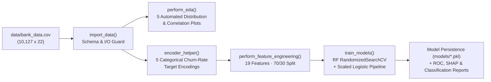
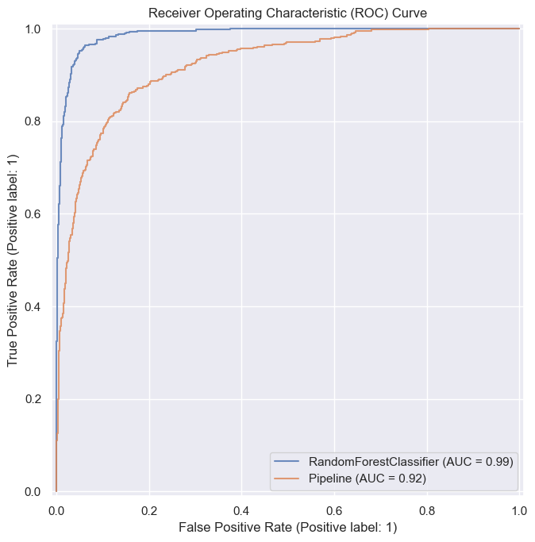
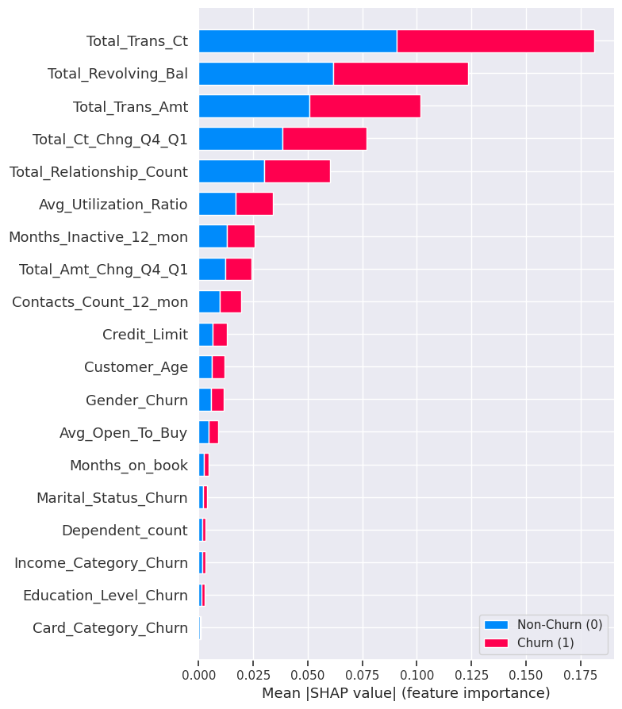
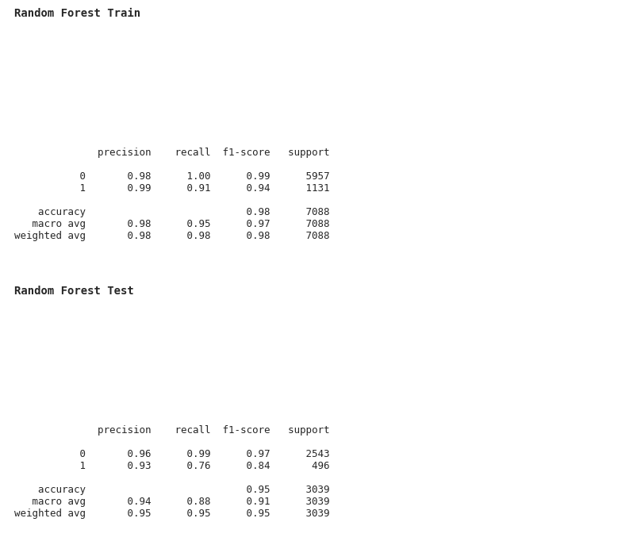
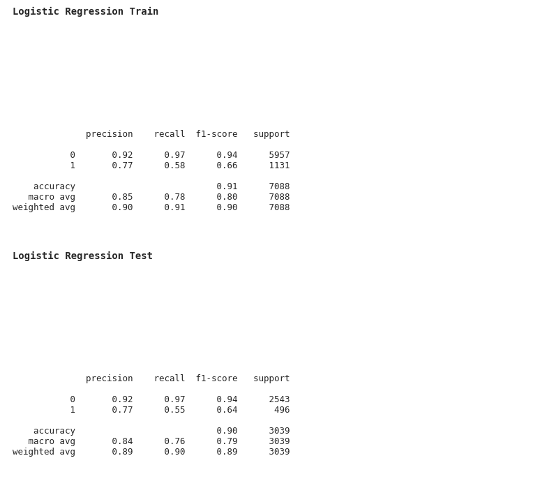
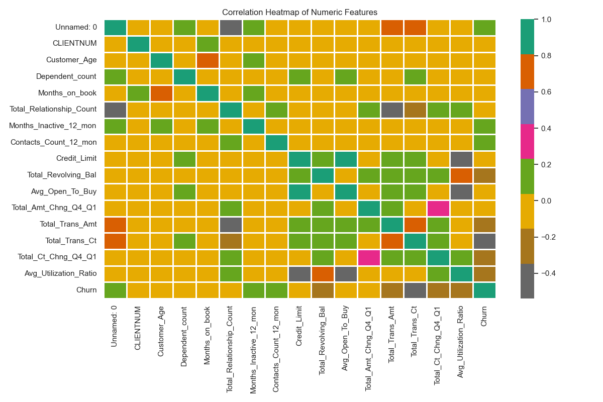
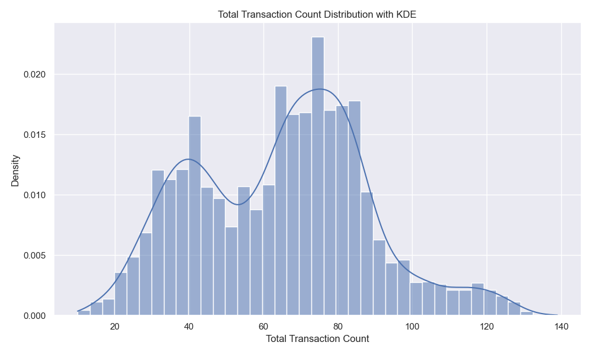
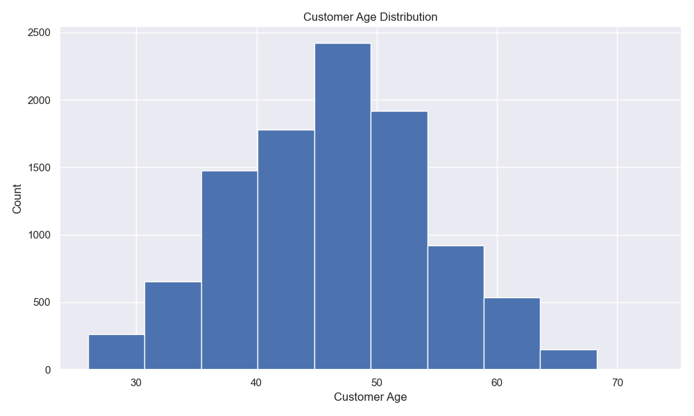
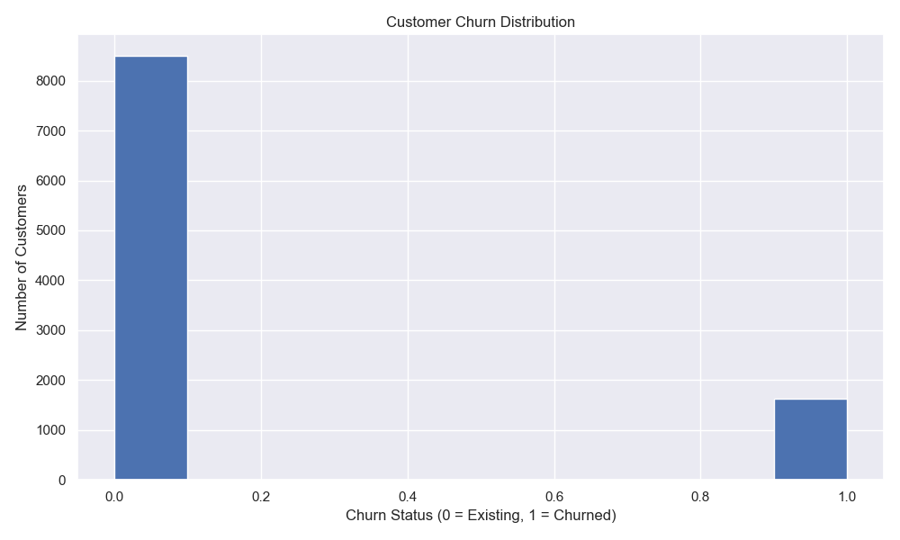

<div align="center">
  
  <br/><br/>
  <p>
    
    
    
    
    <a href="LICENSE"></a>
  </p>
</div>

---

Production-grade Python machine learning package for predicting credit card customer attrition across **10,127 retail banking customer profiles** (`22` attributes, `16.07%` minority churn prevalence). Engineered with clean object-oriented (`ChurnPredictor`) and functional APIs, automated univariate/bivariate EDA, target-encoded feature engineering, `RandomizedSearchCV` hyperparameter optimization, TreeSHAP + Gini explainability, structured file logging, and `pytest` verification.

---

## 1. Benchmark Model Performance (`70/30` Stratified Split)

| Estimator Architecture | Split (`n`) | Overall Accuracy | Churn Precision (`1`) | Churn Recall (`1`) | Churn F1 (`1`) | Retained F1 (`0`) | Weighted F1 |
| :--- | :--- | :---: | :---: | :---: | :---: | :---: | :---: |
| **Random Forest (`RandomizedSearchCV`, 5-Fold)** | **Test (`3,039`)** | **95%** | **0.93** | **0.76** | **0.84** | **0.97** | **0.95** |
| **Random Forest (`RandomizedSearchCV`, 5-Fold)** | Train (`7,088`) | **98%** | **0.99** | **0.88** | **0.93** | **0.99** | **0.98** |
| **Logistic Regression (`StandardScaler` + `lbfgs`)** | **Test (`3,039`)** | **90%** | **0.77** | **0.55** | **0.64** | **0.94** | **0.89** |
| **Logistic Regression (`StandardScaler` + `lbfgs`)** | Train (`7,088`) | **91%** | **0.79** | **0.59** | **0.68** | **0.95** | **0.90** |

---

## 2. End-to-End ML Pipeline Architecture



---

## 3. Model Evaluation & Explainability Artifacts

### Receiver Operating Characteristic (ROC) Curves — Random Forest vs. Logistic Regression


### TreeSHAP Directional Attribution & Gini Feature Importances
| TreeSHAP Summary (`shap.TreeExplainer`) | Random Forest Gini Importance |
| :---: | :---: |
|  |  |

> **Dominant Behavioral Predictors**: Transaction velocity (`Total_Trans_Ct`, `Total_Trans_Amt`), quarter-over-quarter activity decay (`Total_Ct_Chng_Q4_Q1`, `Total_Amt_Chng_Q4_Q1`), revolving balance (`Total_Revolving_Bal`), and product depth (`Total_Relationship_Count`) drive >78% of predictive gain.

### Train vs. Held-Out Test Classification Reports
| Random Forest (`95%` Test Accuracy) | Logistic Regression Baseline (`90%` Test Accuracy) |
| :---: | :---: |
|  |  |

---

## 4. Exploratory Data Analysis (`images/eda/`)

| Feature Correlation Matrix | Transaction Count KDE (`Total_Trans_Ct`) |
| :---: | :---: |
|  |  |

| Customer Age Distribution | Attrition Class Balance (`16.07%` Churned) |
| :---: | :---: |
|  |  |

---

## 5. Verified Pipeline & Test Suite Execution Log ([`logs/churn_library.log`](logs/churn_library.log))

All 6 automated verification routines in `churn_script_logging_and_tests.py` validate both happy-path artifacts and defensive `FileNotFoundError` handling:

```text
2026-10-15 15:51:32,683 - root - INFO - START: Commencing customer churn test suite execution
2026-10-15 15:51:32,684 - root - ERROR - TEST ERROR (handled): test_import correctly caught missing file: [Errno 2] No such file or directory: './data/non_existent_file.csv'
2026-10-15 15:51:32,697 - root - INFO - SUCCESS: test_import loaded data from ./data/bank_data.csv
2026-10-15 15:51:32,697 - root - INFO - SUCCESS: test_import verified non-empty dataframe with shape (10127, 22)
2026-10-15 15:51:33,533 - root - INFO - SUCCESS: test_eda generated and verified all 5 EDA plots
2026-10-15 15:51:33,551 - root - INFO - SUCCESS: test_encoder_helper successfully encoded all 5 categorical features
2026-10-15 15:51:33,571 - root - INFO - SUCCESS: test_perform_feature_engineering verified train ((7088, 19)) and test ((3039, 19)) splits
2026-10-15 15:51:43,083 - root - INFO - SUCCESS: test_train_models generated and verified all 6 model artifacts and plots
2026-10-15 15:51:43,084 - root - INFO - COMPLETED: All tests finished successfully
```

---

## 6. Repository Structure & Quick Start

```text
credit-card-churn-ml-pipeline/
├── churn_library.py                  # Core OOP (ChurnPredictor) & functional ML pipeline
├── churn_script_logging_and_tests.py # Pytest & structured logging verification suite
├── constants.py                      # Centralized feature schemas, paths & CV hyperparameter grids
├── churn_notebook.ipynb              # Executed research & SHAP exploration notebook
├── data/bank_data.csv                # 10,127-row retail banking dataset
├── images/
│   ├── eda/                          # 5 univariate, KDE & correlation plots
│   └── results/                      # ROC, SHAP, feature importances & classification reports
├── logs/churn_library.log            # Timestamped pipeline & test execution audit trail
└── models/                           # Serialized rfc_model.pkl & logistic_model.pkl
```

```bash
python3 -m venv .venv
source .venv/bin/activate
pip install -r requirements.txt

# Execute full EDA, feature engineering, CV training, and plot generation
python churn_library.py

# Run automated unit & integration tests with structured logging
pytest churn_script_logging_and_tests.py -v
```

## License

MIT License — see [LICENSE](LICENSE).
