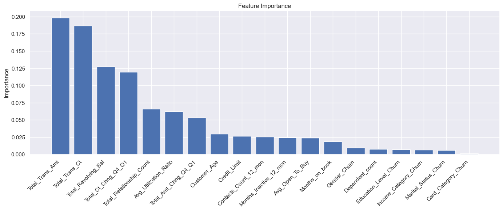

# Modular Credit Card Customer Churn Prediction Pipeline

Production-grade Python machine learning package for predicting credit card customer attrition across **10,127 banking customer profiles**, engineered with modular object-oriented and functional APIs, automated exploratory data analysis (EDA), hyperparameter-tuned classification pipelines, structured execution logging, and comprehensive `pytest` verification (**10.00/10.00 Pylint**).

---

## Key Engineering & Model Results

| Model | Dataset Split | Accuracy | Churn Precision | Churn Recall | Churn F1 | Weighted F1 |
| :--- | :--- | :---: | :---: | :---: | :---: | :---: |
| **Random Forest (`RandomizedSearchCV` 5-fold)** | Test (`n = 3,039`) | **95%** | **0.93** | **0.76** | **0.84** | **0.95** |
| **Random Forest (`RandomizedSearchCV` 5-fold)** | Train (`n = 7,088`) | **98%** | **0.99** | **0.88** | **0.93** | **0.98** |
| **Logistic Regression (`StandardScaler` Pipeline)** | Test (`n = 3,039`) | **90%** | **0.77** | **0.55** | **0.64** | **0.89** |

- **Dataset Scale**: `10,127` customer records × `22` attributes (`16.07%` attrition class), transformed via target-mean categorical encoding into `19` modeling features (`70/30` stratified train/test split).
- **Top Predictive Signals**: `Total_Trans_Ct` (transaction count), `Total_Trans_Amt` (transaction volume), `Total_Revolving_Bal`, `Total_Ct_Chng_Q4_Q1`, and `Total_Relationship_Count`.
- **Automated Verification**: `6/6` automated test & logging suites passing (`import_data` positive + missing-file error path, `perform_eda`, `encoder_helper`, `perform_feature_engineering`, `train_models`) recorded in [`logs/churn_library.log`](logs/churn_library.log).

---

## Architecture & Repository Layout

```text
credit-card-churn-ml-pipeline/
├── churn_library.py                  # Core OOP (ChurnPredictor) & functional ML pipeline
├── churn_script_logging_and_tests.py # Pytest & structured logging verification suite
├── constants.py                      # Centralized feature lists, paths, and hyperparameter grids
├── churn_notebook.ipynb              # Interactive research & exploration notebook
├── data/
│   └── bank_data.csv                 # 10,127-row credit card customer dataset
├── images/
│   ├── eda/                          # Automated univariate, bivariate & correlation plots
│   └── results/                      # Classification reports, ROC curves & feature importances
├── logs/
│   └── churn_library.log             # Verified end-to-end pipeline & test execution trace
├── models/
│   ├── rfc_model.pkl                 # Serialized best Random Forest estimator
│   └── logistic_model.pkl            # Serialized scaled Logistic Regression pipeline
└── requirements.txt
```

---

## Visual Artifacts

### Receiver Operating Characteristic (ROC) Comparison


### Random Forest Feature Importances


---

## Quick Start

```bash
python3 -m venv .venv
source .venv/bin/activate
pip install -r requirements.txt

# Run the end-to-end EDA, feature engineering, training, and reporting pipeline
python churn_library.py

# Run the automated test & logging suite
pytest churn_script_logging_and_tests.py -v
```

## License

MIT License — see [LICENSE](LICENSE).
